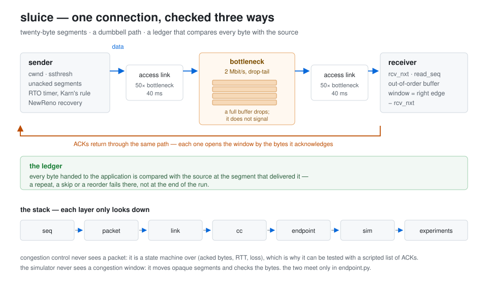

# sluice

**A packet-level TCP laboratory in pure Python: three congestion controls, one wire, and a ledger that checks every byte as it lands.**

<p align="left">
  <a href="https://github.com/18971181532/sluice/actions/workflows/tests.yml"></a>
  
  
  
  
</p>



A congestion control algorithm is a theory about **why packets are lost**. Reno says loss means the
buffer is full, so halve the window. CUBIC says loss is a checkpoint, so climb back fast and then
flatten. Vegas says the queue is visible in the RTT before it is visible in the loss counter, so
watch the delay instead.

Those are three different theories, and they are testable. sluice puts all three on the same
simulated wire, runs the same experiments against each, and checks the result against theory
(Mathis), against fairness (Jain), and against the one thing that is not a theory at all: the bytes
either arrived, in order, exactly once, or they did not.

Nothing here is a wrapper around a library. The header is encoded by hand, the sequence arithmetic
wraps on purpose, the event loop is a heap, and the whole thing is the standard library.

## Quick start

Requirements: **Python 3.10 or newer, and nothing else.** No third-party packages, no build step, no
network access -- the tests, the demos and every experiment run on the standard library alone. The
suite is run on Linux, macOS and Windows for Python 3.10 to 3.13.

```console
$ pip install .          # installs the `sluice` command
```

Or straight from a checkout, with no install step:

```console
$ python run.py run --cc reno --seconds 10 --loss 0.01
reno over 2 Mbit/s, 80 ms RTT, 200 segment buffer, 1% loss, 10 s
delivered    1.0 MB  (0.86 Mbit/s)
segments     1,062 sent, 15 retransmitted
loss events  12 fast retransmit, 0 timeout
srtt / rto   87.0 ms / 200 ms
queueing     3.9 ms average

56 ┤     ╭╮
   ┤     ││
   ┤     ││
40 ┤    ╭╯│
   ┤    │ │  ╭╮
   ┤   ╭╯ │ ╭╯│                                              ╭╮
23 ┤   │  ╰─╯ │                                              ││
   ┤   │      ╰╮             ╭╮   ╭─╮   ╭─╮    ╭╮  ╭╮    ╭───╯│ ╭─╮
   ┤   │       │╭─╮ ╭──╮ ╭───╯╰───╯ │╭──╯ │╭───╯╰──╯│╭───╯    ╰─╯ │╭──
   ┤ ╭─╯       ╰╯ ╰─╯  ╰─╯          ╰╯    ╰╯        ╰╯            ╰╯
 0 ┤─╯
   └──────────────────────────────────────────────────────────────────
    0                                                  10.0 s     (congestion window, KB)
```

Six more experiments ship with the package:

```console
$ python run.py loss --all      # throughput against loss, next to Mathis
$ python run.py bloat           # same throughput, different queueing delay
$ python run.py fair            # four flows, one bottleneck, Jain's index
$ python run.py mix             # Reno and Vegas in the same buffer
$ python run.py wrap            # a transfer that crosses 2**32
$ python run.py tail            # the loss no duplicate ACK can repair
$ python run.py demo sawtooth   # six self-checking demonstrations
```

Every command accepts `--json`, and every number in this README was produced by the command printed
above it. The simulator is deterministic, so those numbers reproduce exactly on any machine with
Python 3.10 or newer: same seed, same packet order, same output.

## What is implemented

**The wire.** A twenty-byte header with big-endian fields, the real one's-complement checksum, and
strict decoding: a wrong length, a non-zero reserved byte, or a single flipped bit is rejected.
No options -- no SACK, no timestamps, no window scaling -- which is why the receive window tops out
at 64 KB and every scenario in this project is sized to fit inside it.

**The connection.** Three-way handshake, FIN teardown, cumulative ACKs with 40 ms delayed ACK,
receiver flow control including a zero window and a later update, sequence numbers that wrap.

**The sender.** The ACK clock, slow start, congestion avoidance, fast retransmit after three
duplicate ACKs, **NewReno partial ACK** (a second loss in the same window is repaired immediately,
not after a timeout), RTT estimation per RFC 6298 with Karn's rule, and exponential backoff on
timeout up to 60 seconds.

**The controls.** Reno (RFC 5681), the core of CUBIC (RFC 8312: `W(t) = C(t-K)^3 + W_max`, beta 0.7),
and Vegas (delay-based, alpha 1 / beta 3, a quarter off the window per duplicate-ACK loss).

**The world.** A dumbbell topology: every flow crosses one bottleneck with a finite drop-tail buffer.
Links model serialisation exactly (a 1000-byte segment on a 2 Mbit/s link takes 4 ms to clock out,
no matter what else is queued) and propagation as a constant.

**The ledger.** Every byte handed to the application is compared with the source *at the segment
that delivered it*. A repeat, a skip, or a reorder fails at the culprit, not at the end of the run.

## The measurements

### 1. Loss is a theory, and theory can be checked

`python run.py loss --all`. A single flow, ten seconds per cell, 2 Mbit/s and 80 ms RTT. The
`Mathis` column is `MSS/RTT x 1.22/sqrt(p)` computed from the *propagation* delay, so it is an
independent prediction rather than a fit:

| loss | reno | cubic | vegas | Mathis |
| ---: | ---: | ---: | ---: | ---: |
| 0.0% | 1.90 | 1.90 | 1.85 | — |
| 0.2% | 1.63 | 1.85 | 1.63 | 2.73 (link) |
| 1.0% | 0.86 | 0.89 | 1.07 | 1.22 |
| 3.0% | 0.57 | 0.53 | 0.59 | 0.70 |

Two things worth reading off that table. First, the measured throughput sits 12% to 40% below the
prediction across the nine cells: Mathis assumes every loss is repaired in one round trip, and a
stack without SACK pays for the second loss in a window with a timeout. Second, **CUBIC is not
faster than Reno here** -- at a bandwidth-delay product of 20 KB its cubic growth has nowhere to
show off, and the table says so instead of flattering it.

### 2. Bufferbloat is a latency problem wearing a bandwidth costume

`python run.py bloat`. No random loss at all; the queue is the only signal. A 1 Mbit/s link with a
300-segment buffer and a 64 KB receive window, which is exactly the mismatch that made home routers
famous:

```
control  Mbit/s  avg queue  peak queue  retx
───────  ──────  ─────────  ──────────  ────
reno       0.96     309 ms      449 ms     0
cubic      0.96     309 ms      449 ms     0
vegas      0.95      20 ms       32 ms     0
```

Same throughput within one percent. Reno and CUBIC only stop when the receive window runs out, so
they leave a full buffer behind: **309 ms of standing delay**. Vegas notices the RTT rising and holds
at 20 ms. The cost of a full buffer is not bandwidth, it is latency, and only the delay-based sender
refuses to pay it.

### 3. Same algorithm, same path, even split

`python run.py fair`. Four Reno flows, ten seconds, three seeds:

```
seed             per-flow Mbit/s   Jain
────  ──────────────────────────  ─────
   0   0.47   0.47   0.50   0.49  0.999
   1   0.45   0.50   0.48   0.50  0.998
   2   0.50   0.49   0.47   0.48  0.999
```

Mean Jain index **0.999**. This is a weaker claim than it looks: the receive window here is 16 KB,
about three times a flow's fair share, so a flow that times out cannot fall far behind. Pass
`--window 65535` and the same four flows score 0.928, 0.856 and 0.955 on the same three seeds --
0.913 on average, because one timeout then costs a flow a large fraction of its window. The smaller
window is a choice, and the README says so.

### 4. Two theories in one buffer

`python run.py mix`. Reno and Vegas share the bottleneck, averaged over three seeds:

```
control  Mbit/s   share  retx  queue
reno       1.00  55.53%    23  24 ms
vegas      0.80  44.47%    12  23 ms

Jain per seed: 1.000, 0.999, 0.911
```

The loss-based sender takes about 55% of the link and the delay-based one about 45%. No starvation,
no collapse -- but a consistent disadvantage for the sender that backs off earlier. That is the
price of politeness, measured rather than asserted.

### 5. The counter wraps, and nothing notices

`python run.py wrap`. The connection starts at `2**32 - 3,000` and sends 200,000 bytes, so it crosses
zero 3,000 bytes in:

```
initial sequence number 4,294,964,296 (2**32 - 3,000)
transfer 200,000 bytes, crossing 2**32 after 3,000

delivered    200,000 bytes
in order     yes
wrapped      yes
retransmits  0
throughput   0.93 Mbit/s
```

Every comparison goes through `seq.compare()`, which only ever looks at a forward distance smaller
than `2**31`. Subtracting two sequence numbers directly is the bug this module exists to prevent, and
the test suite walks a 4,000-byte window across the boundary to prove it.

### 6. The loss that only a timer can repair

`python run.py tail`. The last segment of a 50 KB transfer is dropped every time it is sent. Nothing
follows it, so no duplicate ACKs ever arrive:

```
timeout      at    RTO
      1  0.91 s  0.4 s
      2  1.31 s  0.8 s
      3  2.11 s  1.6 s
      4  3.71 s  3.2 s
      5  6.91 s  6.4 s
```

Waiting is the only option, and each wait doubles. A stack without SACK or RACK pays this bill once
per tail loss; this is what that bill looks like.

## Using it as a library

The command line is a thin wrapper. A control, a scenario and a path are enough to build your own
experiment -- no simulator object to configure, no event loop to drive:

```python
from sluice import Reno, Vegas, experiments

scenario = experiments.Scenario(mbps=2.0, rtt_ms=80.0, loss=0.01)
for control in (Reno(1000), Vegas(1000)):
    run = experiments.transfer(control, scenario)
    flow = run.by_name("flow")
    print(f"{flow.control:6}  {flow.mbps:4.2f} Mbit/s  "
          f"{flow.retransmits:3d} retransmits  {flow.avg_queue_delay * 1000:5.1f} ms queue")
```

```console
reno    0.86 Mbit/s   15 retransmits    3.9 ms queue
vegas   1.07 Mbit/s   17 retransmits    3.0 ms queue
```

`FlowResult` carries the rest of the sample -- `timeouts`, `fast_retransmits`, `srtt`, `rto`, the
per-sample window and RTT series -- which is what the charts are drawn from.

Want the packets without the topology? `examples/walkthrough.py` wires a sender to a receiver over
forty lines of hand-rolled wire and prints every segment in order, handshake included. That file is
the shortest proof that `endpoint.py` does not import `sim.py`.

## How it works

### The header

Twenty bytes, laid out where TCP puts them. The checksum is computed over the header with its own
field zeroed, followed by the payload:

```
 0                   1                   2                   3
+-------------------------------+-------------------------------+
|          source port          |       destination port        |
+-------------------------------+-------------------------------+
|                        sequence number                        |
+-------------------------------+-------------------------------+
|                    acknowledgment number                      |
+-------------------------------+-------------------------------+
|  flags  |  reserved (must be 0) |            window             |
+-------------------------------+-------------------------------+
|           checksum            |         payload length        |
+-------------------------------+-------------------------------+
```

`Segment.decode()` refuses anything it cannot fully justify, and `test_packet.py` flips each of the
160 header bits in turn to check that every one of them is caught.

### The layers

| module | knows about | does not know about |
| --- | --- | --- |
| `seq` | 32-bit arithmetic on a circle | everything else |
| `packet` | bytes and flags | connections |
| `link` | serialisation, propagation, queues | TCP |
| `cc` | acked bytes, RTT, loss | packets, ports, time |
| `endpoint` | windows, timers, ACKs | topology |
| `sim` | events, flows, the ledger | congestion control |
| `experiments` | scenarios | presentation |

The separation is not decoration. `cc.py` can be tested with a scripted list of ACKs and no network
at all, which is why the cubic curve is pinned down to six decimal places in `test_cc.py`. `sim.py`
can swap in a corrupted receiver and watch the ledger catch it, which is what `test_sim.py` does.

### Congestion control is a pure state machine

All three controls see the same four events -- an ACK that advances the window, a duplicate ACK, a
timeout, an RTT sample -- and produce the same one output. The sender never asks which one it is
holding. That is what makes the comparison a comparison.

The sender implements NewReno, not Reno: when a partial ACK arrives inside fast recovery, the next
hole is retransmitted immediately. Without that rule a window with two losses stalls for a full
second, which is precisely what this project measured before the rule was added (see the bug list).

### The receive window is a right edge, not free space

The subtlest bug in the whole project. Advertising "bytes still free" moves the window's right edge
*left* whenever an out-of-order segment arrives -- and the sender has already put those bytes on the
wire. They then fall outside the window, get discarded, and only a timeout recovers them.

The receiver therefore advertises `read_seq + rcvbuf - rcv_nxt`: a fixed right edge that only moves
when the application reads. Fixing this turned a 0.37 Mbit/s collapse at 0.1% loss into 1.83 Mbit/s.

### Determinism

One `random.Random(seed)`, drawn in event order. The heap breaks ties by insertion order. The same seed
produces the same trace byte for byte, so `sluice trace` output can be diffed between runs, and the
numbers in this README can be reproduced instead of trusted.

## Limits and non-goals

These are choices, not oversights. Each one costs something, and the cost is stated:

- **No SACK, no timestamps, no window scaling.** The window field is 16 bits, so 64 KB is the ceiling.
  Every scenario here has a bandwidth-delay product well under that; a real stack would negotiate a
  scale factor in the SYN.
- **No packet reordering, no bursty loss.** Loss is independent per segment. Real bottlenecks drop
  trains of packets, which is exactly where SACK earns its keep.
- **One bottleneck, always.** The dumbbell is the simplest topology that produces congestion; parking-lot
  and multi-hop topologies are not modelled.
- **No Nagle, no urgent data, no half-close, no TIME_WAIT.** The FIN is a full close.
- **The receive window is 16 KB or 64 KB, fixed at start-up.** No autotuning.
- **Python speed.** A ten-second experiment costs about 35 ms of wall clock; a million-packet run
  would not.
- **The checksum catches corruption, not forgery.** It is a checksum.

## Bugs this project found

The first five were caught by tests and by reading the trace; the last two were caught by looking at
what the program printed rather than by an assertion:

1. **`seq.compare()` had the subtraction backwards.** `a - b` where the RFC says `b - a`, so
   `before(5, 0)` was true. Six tests failed at once, which is the good kind of bug.
2. **The receive window was free space, not a right edge.** Out-of-order data shrank the window
   below what was already in flight; the sender's later segments were discarded as out-of-window and
   recovered one per RTO. Throughput at 0.1% loss was 0.37 Mbit/s instead of 1.83.
3. **Reno without NewReno stalled inside fast recovery.** Two losses in a window left the sender
   inflating its window forever on duplicate ACKs, because the recovery point could never be
   acknowledged. A 5-second run spent 4 seconds in recovery.
4. **`bytes_acked` counted the FIN as data.** A 200,000-byte transfer reported 200,001 bytes
   delivered. Throughput now counts payload only.
5. **`loss_sweep` reused one control object across rows.** Each row inherited the previous row's
   window and base RTT, so the table was measuring one long connection chopped into four pieces.
   Vegas's row at 0.2% loss read 0.79 Mbit/s instead of 1.63.
6. **A 40 ms delayed ACK inflated the first RTT sample.** With a one-segment window every round trip
   pays the delayed-ACK timer, so the first `srtt` is 135 ms on a 100 ms path. That one is not a bug
   in the code; it is a real TCP behaviour that the measurement exposed, and the test now asserts it.
7. **The chart dropped unsampled buckets to zero.** Samples are event times, not a fixed grid, so a
   time bucket with no sample was drawn at zero: a sparse series came out as a comb of spikes, and
   the ascent corners were the descent pair mirrored. Holding the last value and using `╭` / `╯` for
   a climb fixed both. The picture was wrong in a way no table would have shown.

## Tests

210 cases, 1.2 seconds, no dependencies:

| file | cases | what it pins down |
| --- | ---: | --- |
| `test_seq.py` | 21 | wraparound arithmetic, intervals, overlap, a 4,000-byte window walked across `2**32` |
| `test_packet.py` | 28 | round trips, every single-bit flip rejected, truncated and malformed headers |
| `test_link.py` | 24 | serialisation, queueing, drop-tail, reproducible loss |
| `test_cc.py` | 28 | slow start doubling, additive increase, cubic's K, Vegas's corridor |
| `test_endpoint.py` | 22 | handshake, retransmission, Karn, window zero, delayed ACK, FIN |
| `test_sim.py` | 15 | determinism, the ledger catching an extra or missing byte, Jain's index |
| `test_experiments.py` | 14 | every scenario moves in the right direction |
| `test_render.py` | 28 | CJK widths, alignment, charts, sample gaps |
| `test_cli.py` | 25 | all nine subcommands, JSON, exit codes |
| `test_demos.py` | 5 | each demonstration still proves its own claim |

```console
$ python run_tests.py
Ran 210 tests in 1.253s
OK
```

The crash-style tests are in `test_sim.py`: a receiver that appends a byte, and one that deletes a
byte, both have to be caught by the ledger at the segment where it happened.

## Command line

```
sluice run     one bulk transfer, with a chart of the window
sluice loss    throughput against loss rate, next to Mathis
sluice fair    N identical flows, Jain's index per seed
sluice mix     different controls on the same bottleneck
sluice bloat   queueing delay when nothing is lost
sluice wrap    a transfer that crosses 2**32
sluice tail    a loss that only a timer can repair
sluice trace   the first segments of a run, in order
sluice demo    six demonstrations that check themselves
```

Common options: `--cc reno|cubic|vegas`, `--mbps`, `--rtt`, `--queue` (segments), `--seconds`,
`--window` (bytes), `--json`.

| exit | meaning |
| ---: | --- |
| 0 | the experiment ran; the numbers are in the output |
| 1 | an invariant broke: a byte was lost, repeated or reordered |
| 2 | the command line did not make sense |

## Layout

```
sluice/
├── sluice/
│   ├── seq.py           109 lines   32-bit arithmetic on a circle
│   ├── packet.py        183 lines   twenty bytes, encoded by hand
│   ├── link.py          187 lines   serialisation, propagation, drop-tail
│   ├── cc.py            289 lines   Reno, CUBIC, Vegas behind one interface
│   ├── endpoint.py      578 lines   sender and receiver state machines
│   ├── sim.py           377 lines   event loop, flows, the byte ledger
│   ├── experiments.py   308 lines   the scenarios this README quotes
│   ├── render.py        214 lines   tables, charts, units
│   ├── cli.py           445 lines   nine subcommands, three exit codes
│   ├── demos.py         227 lines   six self-checking demonstrations
│   └── __init__.py       35 lines
├── tests/              1,667 lines  ten files, 210 cases
├── examples/
│   ├── walkthrough.py              drive a connection with no simulator
│   ├── sweep.py                    the loss table as markdown
│   └── chart.py                    three window curves, side by side
├── docs/architecture.svg
├── run.py                         run from a checkout
├── run_tests.py                   the whole suite
├── run_demos.py                   all six demonstrations
├── pyproject.toml                 packaging, and the `sluice` entry point
├── .github/workflows/tests.yml    3 operating systems, Python 3.10 to 3.13
└── LICENSE
```

2,952 lines of engine, 1,667 lines of tests, no dependencies, one standard library.

## References

- RFC 5681, *TCP Congestion Control* (Reno, fast retransmit, fast recovery)
- RFC 6582, *The NewReno Modification*
- RFC 8312, *CUBIC for Fast Long-Distance Networks*
- RFC 6298, *Computing TCP's Retransmission Timer*
- RFC 1982, *Serial Number Arithmetic*
- Brakmo & Peterson, *TCP Vegas: End to End Congestion Avoidance on a Global Internet* (1995)
- Mathis et al., *The Macroscopic Behavior of the TCP Congestion Avoidance Algorithm* (1997)

## Licence

MIT. See [LICENSE](LICENSE).
